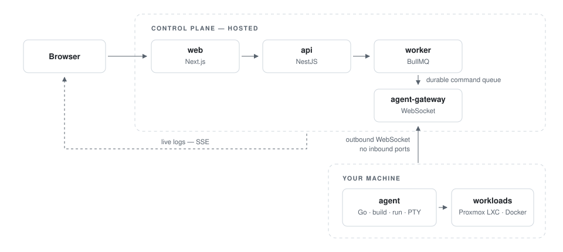

<!-- GitHub organization profile. Copy this folder's files into the org's `.github` repo under `profile/`. -->
<div align="center">

<picture>
  <source media="(prefers-color-scheme: dark)" srcset="ownship-icon-light.svg" width="72">
  
</picture>

# Ownship

**A hosted deploy platform for your own hardware: a mini-Vercel/Railway for any machine you control, from a homelab to a company server.**

Push to Git. Ownship builds it, runs it on *your* machine and gives it a public URL.
No inbound ports, no Dockerfile required, no cloud bill for compute.

[Website](https://ownship.dev) · [Docs](https://docs.ownship.dev) · [API reference](https://reference.ownship.dev) · [Status](https://status.ownship.dev)

</div>

---

## How it works

You keep the hardware; Ownship gives it a PaaS experience. You install one small Go agent on
your machine (a Proxmox cluster or a plain Docker host) and pair it from the dashboard. The agent
**dials out** to the hosted control plane over a WebSocket, so your network exposes nothing
inbound. Your code, secrets and containers stay on your machine; the control plane only
orchestrates.

<picture>
  <source media="(prefers-color-scheme: dark)" srcset="architecture-dark.svg">
  
</picture>

1. **Sign up** and **pair a machine** with `ownship-agent pair <CODE>`.
2. **Create a project** from a Git repo (GitHub, GitLab, Gitea/Forgejo or any Git server over SSH),
   a docker-compose file, or a one-click template.
3. **Deploy**: Ownship builds with Nixpacks (or runs a prebuilt image), boots it in an LXC, VM or
   container on your machine, health-checks it and routes it through your Cloudflare Tunnel.
4. **Operate** from the dashboard, the `ownship` CLI or MCP.

## What you get

- **Git deploys**: Nixpacks auto-build, build cache, deploy hooks, scheduled deploys, a CI deploy URL.
- **Safe by default**: a new deploy must pass its health check before taking traffic, and a failed
  one rolls back to the last good image. One-click rollback to any deploy.
- **Previews and stages**: every pull request gets its own environment and URL; promote staging to production.
- **Traffic**: public URLs through Cloudflare Tunnel, custom domains, or private access over your LAN or Tailscale.
- **Stateful workloads**: volumes, one-click Postgres / Redis / MySQL / MongoDB with a database studio,
  encrypted backups, an off-site backup buddy and failover to a standby machine.
- **Day-2 operations**: live logs, metrics, monitoring and alerts, a web terminal, cron and one-off
  commands, sleep/wake on request, notifications on Discord, Slack and email.
- **Teams**: organizations with custom roles, an audit log, passkeys and two-factor sign-in.
- **Programmatic access**: scoped API tokens, the `ownship` CLI and an MCP server.

```sh
curl -fsSL https://assets.ownship.dev/install-cli.sh | sh
ownship login          # paste an API token
ownship link my-api    # bind this directory to a project
ownship deploy         # deploy + stream build logs
ownship logs --runtime # tail the running app
```

## Built to be trusted

- Every secret is encrypted under a per-organization key (AES-256-GCM with envelope encryption).
- The agent is only semi-trusted: the control plane checks that every id it reports belongs to that machine.
- Commands run on your machine in argv form, never through a shell; secrets never touch the command line.
- Backups are sealed on your machine before they leave it; storage only ever holds ciphertext.
- The agent updates itself only from ed25519-signed releases, with a downgrade guard and rollback.

<div align="center">

**[Get started at ownship.dev](https://ownship.dev)**

</div>
